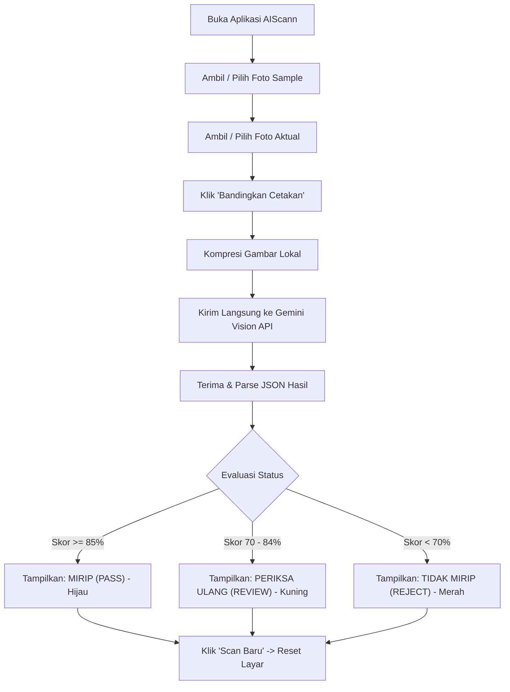

# Product Requirements Document (PRD)

## 1. Overview
**Nama Proyek:** AIScann (AI Sack Printing Inspection)  
**Tipe Aplikasi:** Standalone Mobile App (Android via Flutter) — **Serverless / Direct-to-AI**  
**Fungsi Utama:** Membandingkan foto cetakan karung standar (*sample/master*) dengan hasil cetak produksi (*aktual*) secara langsung (*stateless*) menggunakan Google Gemini Multimodal Vision API. Aplikasi berjalan tanpa backend dan tanpa database—langsung menganalisis dan menampilkan apakah hasil cetak sudah mirip/sesuai atau belum.

---

## 2. Problem & Goals

### 2.1 Problem Statement
- Operator lini cetak karung membutuhkan alat bantu cepat dan praktis di genggaman untuk memverifikasi apakah cetakan karung yang baru keluar dari mesin sudah mirip/sesuai dengan karung master (*sample proof*).
- Solusi berbasis server/database terlalu berlebihan (*over-engineering*) untuk kebutuhan inspeksi instan di lapangan yang hanya memerlukan verifikasi detik itu juga (*scan → bandingkan → tampilkan hasil*).
- Cacat cetak kritis yang perlu diperiksa: teks salah/buram (*typo* pada netto/merk/batch), warna pudar atau meleset, logo/gambar bergeser (*misalignment*), serta noda atau lubang tinta (*ink voids/smudges*).

### 2.2 Goals
1. Menyediakan aplikasi Android mandiri (*standalone*) yang ringan dan cepat.
2. Memungkinkan operator mengambil atau memilih 2 foto: **Foto Sample** dan **Foto Aktual**.
3. Menghubungkan aplikasi langsung ke **Google Gemini Multimodal Vision API** tanpa server perantara (*direct API call*).
4. Menyajikan keputusan instan: **MIRIP / PASS** atau **TIDAK MIRIP / REJECT**, lengkap dengan skor kemiripan (0–100%) dan poin perbedaan konkret.
5. Sifat aplikasi sepenuhnya *stateless*: setelah hasil dilihat dan diverifikasi oleh operator, aplikasi dapat langsung di-reset untuk karung berikutnya tanpa beban penyimpanan database.

---

## 3. Users & Roles

| Role | Deskripsi | Kebutuhan Utama |
|---|---|---|
| **Operator Mesin / QC Lapangan** | Pengguna tunggal aplikasi di lantai produksi | Membuka aplikasi, memotret karung sample & karung aktual, melihat hasil kemiripan dalam hitungan detik, lalu menyesuaikan setelan mesin cetak jika tidak mirip. |

*Catatan: Tidak ada sistem multi-user atau role kompleks. Satu aplikasi dapat digunakan oleh operator mana pun di lantai produksi.*

---

## 4. Scope

### 4.1 In-Scope (Lean MVP)
- **Pengambilan Gambar:**
  - Kamera dengan panduan bingkai (*framing guide overlay*) untuk memastikan karung terfoto rata.
  - Dukungan memilih foto dari Galeri HP (jika sample sudah difoto sebelumnya).
- **Pengolahan & Kompresi:**
  - Kompresi gambar otomatis di HP (skala maksimal 1280px, kualitas 80%) agar pengiriman ke Gemini API sangat cepat dan hemat kuota data.
- **Integrasi Langsung ke Google Gemini:**
  - Pengiriman pasangan gambar (Sample + Aktual) langsung ke endpoint Gemini Vision API (`gemini-1.5-flash` / `gemini-2.0-flash`).
  - Pengaturan *System Instruction* & *JSON Structured Output* khusus untuk inspeksi QC cetak karung.
  - Pengelolaan API Key fleksibel: Menggunakan Kunci Default (sistem/.env) agar pengguna tidak wajib menginput manual, serta menyediakan menu Pengaturan di dalam aplikasi untuk menambahkan Kunci Kustom dengan validasi testing otomatis sebelum disimpan.
- **Penyajian Hasil Instan:**
  - Status besar & jelas: **MIRIP (PASS)** (Hijau) / **PERIKSA ULANG (REVIEW)** (Kuning) / **TIDAK MIRIP (REJECT)** (Merah).
  - Skor Kemiripan numerik (0–100%).
  - Rincian komparasi: Teks/Tulisan, Warna, Posisi/Presisi, dan Temuan Cacat.
  - Rekomendasi perbaikan untuk operator mesin.
  - Tombol **"Scan Baru / Reset"** untuk memulai pengecekan karung berikutnya.

### 4.2 Out-of-Scope
- Server backend perantara (Node.js/Python ditiadakan).
- Database persisten (SQLite, MySQL, MongoDB tidak digunakan).
- Manajemen akun, login, dan role user.
- Sinkronisasi cloud atau riwayat historis (sesuai arahan: data bersifat sementara/sekali pakai).

---

## 5. Functional Requirements

| ID | Modul | Deskripsi Kebutuhan | Prioritas |
|---|---|---|---|
| **FR-01** | Input Foto Sample | Pengguna dapat mengambil foto karung sample via kamera atau memilih dari galeri. | P0 (Must Have) |
| **FR-02** | Input Foto Aktual | Pengguna dapat mengambil foto karung hasil cetak aktual via kamera atau memilih dari galeri. | P0 (Must Have) |
| **FR-03** | Kompresi Klien | Aplikasi mengompresi kedua foto secara lokal di HP sebelum dikirim ke API Gemini. | P0 (Must Have) |
| **FR-04** | Direct AI Call | Aplikasi mengirim foto bersama prompt QC langsung ke Google Gemini Vision API via HTTPS (mendukung `gemini-3.1-flash-lite`, `gemini-3.5-flash-lite`, dll). | P0 (Must Have) |
| **FR-05** | Parsing Respons | Aplikasi mem-parsing keluaran JSON terstruktur dari Gemini API ke model data aplikasi. | P0 (Must Have) |
| **FR-06** | Tampilan Hasil | Menampilkan status (MIRIP / TIDAK MIRIP), skor (0–100%), rincian perbandingan, dan rekomendasi. | P0 (Must Have) |
| **FR-07** | Reset / Scan Ulang | Tombol satu klik untuk membersihkan foto dan siap memindai karung berikutnya. | P0 (Must Have) |
| **FR-08** | Pengaturan & Validasi API Key | Aplikasi menyediakan Kunci Default bawaan agar langsung siap pakai, sekaligus menyediakan halaman pengaturan untuk menambahkan Kunci Kustom dengan validasi testing sebelum disimpan. | P0 (Must Have) |
| **FR-09** | Mode 1 Foto (Dijejerkan) | Pengguna dapat menjajarkan karung sample di kiri dan karung aktual di kanan dalam 1 frame foto bersamaan untuk komparasi instan. | P0 (Must Have) |
| **FR-10** | Analisis Alasan Skor (%) | AI memberikan penjelasan detail alasan di balik perolehan skor persentase (aspek yang identik vs penyebab pengurangan nilai/penalti). | P0 (Must Have) |
| **FR-11** | Salin Laporan 1-Tap | Tombol satu klik untuk menyalin seluruh ringkasan laporan inspeksi QC ke clipboard untuk dibagikan ke WhatsApp / catatan kerja. | P1 (Nice to Have) |
| **FR-12** | Ikon Launcher Kustom | Ikon aplikasi Android kustom bertema Industrial QC Scanner menggantikan ikon default Flutter. | P1 (Nice to Have) |

---

## 6. Non-Functional Requirements

- **Kecepatan & Responsivitas:**
  - Total durasi proses dari klik "Analisis" hingga hasil tampil di layar ditargetkan $\le 3 - 6$ detik (menggunakan model `gemini-1.5-flash`).
- **Efisiensi Memori & Bandwidth:**
  - Gambar dikompresi menjadi $\sim 300 - 500$ KB per foto di memori HP sebelum dikirim.
  - Tidak meninggalkan tumpukan berkas sampah di penyimpanan HP (foto sementara langsung dibersihkan saat reset).
- **Kemudahan Penggunaan (Usability):**
  - UI ramah operator pabrik: teks besar, warna kontras tinggi, alur 3 langkah sederhana: *Foto Sample → Foto Aktual → Bandingkan*.
- **Tanpa Ketergantungan Server:**
  - Aplikasi dapat beroperasi langsung hanya dengan koneksi internet aktif dari HP ke Google Gemini API (menggunakan Wi-Fi pabrik atau paket data seluler).

---

## 7. Use Cases & User Flows



### 7.1 Detail Langkah Alur Pengguna:
1. Operator membuka aplikasi di Android.
2. Kotak kiri: Tekan ikon kamera untuk memotret **Karung Sample** (Master).
3. Kotak kanan: Tekan ikon kamera untuk memotret **Karung Aktual** (Hasil Mesin).
4. Tombol **"Bandingkan Sekarang"** menjadi aktif. Operator menekannya.
5. Indikator loading berputar dengan keterangan *"Menganalisis kemiripan cetakan..."*.
6. Layar menampilkan hasil perbandingan:
   - Badge status: **MIRIP / PASS** (atau **TIDAK MIRIP / REJECT**).
   - Skor kemiripan: contoh `94%`.
   - Ringkasan singkat: *"Teks, logo, dan tata letak identik dengan sample."*
   - Kartu rincian: Teks (OK), Warna (OK), Posisi (OK), Cacat (Nihil).
7. Operator menekan tombol **"Scan Karung Lain"** untuk mereset layar dan kembali siap memotret.

---

## 8. System Architecture

```text
┌─────────────────────────────────────────────────────────────┐
│                    Aplikasi Mobile Android                 │
│                       (Flutter Engine)                      │
│                                                             │
│   ┌─────────────────────────────────────────────────────┐   │
│   │                 Presentation Layer                  │   │
│   │  - ScanScreen (2 Image Pickers + Compare Button)    │   │
│   │  - ResultDialog / ResultScreen (Score, Status)      │   │
│   │  - SettingsScreen (Input Gemini API Key)            │   │
│   └──────────────────────────┬──────────────────────────┘   │
│                              │                              │
│   ┌──────────────────────────▼──────────────────────────┐   │
│   │                   Service Layer                     │   │
│   │  - ImageCompressorService (Resize to max 1280px)    │   │
│   │  - GeminiVisionService (Direct REST / SDK client)   │   │
│   │  - KeyStorageService (SharedPreferences)            │   │
│   └──────────────────────────┬──────────────────────────┘   │
└──────────────────────────────┼──────────────────────────────┘
                               │
                HTTPS POST (Direct API Call)
                               │
                               ▼
┌─────────────────────────────────────────────────────────────┐
│                  Google Cloud Platform                      │
│        Google Gemini API (gemini-1.5-flash / 2.0-flash)     │
│        - Multimodal Vision Reasoning                        │
│        - Structured JSON Output                             │
└─────────────────────────────────────────────────────────────┘
```

---

## 9. Components & Data Flow

1. **Input Gambar:** Menggunakan plugin `image_picker` untuk mengambil foto dari kamera atau galeri perangkat.
2. **Kompresi:** Menggunakan pustaka `flutter_image_compress` untuk mengecilkan resolusi ke maksimal 1280px dengan kompresi JPEG quality 80%.
3. **Payload Generation:** Gambar dikonversi ke format Base64 dan dikemas bersama System Prompt khusus QC karung.
4. **Direct API Call:** Menggunakan HTTP Client (`http` atau `dio`) mengirimkan request `POST` langsung ke:
   `https://generativelanguage.googleapis.com/v1beta/models/gemini-1.5-flash:generateContent?key={GEMINI_API_KEY}`
5. **JSON Response Processing:** AI merespons dengan JSON terstruktur. Aplikasi mem-parsing ke objek model Dart `InspectionResult`.
6. **Display & Ephemeral Clean-up:** Hasil langsung dirender pada UI. Tidak ada operasi penulisan ke database.

---

## 10. Database Design

**TIDAK ADA DATABASE (None / Stateless).**  
Sesuai kebutuhan pengguna, aplikasi tidak menyimpan data inspeksi ke database lokal maupun server. Setiap sesi komparasi bersifat sementara (*in-memory*). Pengaturan API Key disimpan di penyimpanan lokal bawaan Android (*SharedPreferences* / *Key-Value Store*) agar operator tidak perlu memasukkan API key berulang-ulang.

---

## 11. API / Interface Design (Gemini Vision API)

### 11.1 Format Request ke Gemini
- **Endpoint:** `POST https://generativelanguage.googleapis.com/v1beta/models/gemini-1.5-flash:generateContent?key={API_KEY}`
- **Headers:** `Content-Type: application/json`
- **Body:**
```json
{
  "contents": [
    {
      "role": "user",
      "parts": [
        {
          "text": "Anda adalah auditor Quality Control ahli percetakan karung plastik/sak (packing bags). Tugas Anda membandingkan GAMBAR 1 (Karung Sample Standar/Master) dengan GAMBAR 2 (Hasil Cetak Aktual Mesin). Analisis apakah cetakannya sudah mirip/sesuai standar atau belum. Periksa: 1. Akurasi teks & typo (nomor netto, merk, komposisi). 2. Kesesuaian warna (pudar/meleset). 3. Presisi posisi & pergeseran logo. 4. Cacat fisik (noda tinta, cetakan bolong/botak). Kembalikan HANYA format JSON valid sesuai skema yang diminta."
        },
        {
          "inline_data": {
            "mime_type": "image/jpeg",
            "data": "<BASE64_IMAGE_SAMPLE>"
          }
        },
        {
          "inline_data": {
            "mime_type": "image/jpeg",
            "data": "<BASE64_IMAGE_AKTUAL>"
          }
        }
      ]
    }
  ],
  "generationConfig": {
    "response_mime_type": "application/json",
    "temperature": 0.2
  }
}
```

### 11.2 Format JSON yang Dikembalikan oleh AI
```json
{
  "similarity_score": 92,
  "status": "PASS",
  "is_match": true,
  "summary": "Hasil cetakan sangat mirip dengan sample master. Teks tajam dan warna sesuai.",
  "analysis_details": {
    "text_accuracy": {
      "match": true,
      "notes": "Semua tulisan terbaca jelas dan identik dengan sample."
    },
    "color_fidelity": {
      "match": true,
      "notes": "Warna tinta hijau dan merah sesuai standar."
    },
    "alignment": {
      "match": true,
      "notes": "Tata letak logo presisi di tengah."
    },
    "defects_found": []
  },
  "recommendations": "Kualitas cetakan sudah baik, mesin siap lanjut cetak massal."
}
```

---

## 12. Authentication & Authorization

- Tidak ada login akun.
- Autentikasi hanya berupa **Google Gemini API Key** yang disimpan di pengaturan aplikasi perangkat.

---

## 13. Security

1. **Penyimpanan API Key di Perangkat:**
   - Disimpan secara lokal pada penyimpanan internal aplikasi (*SharedPreferences* / *EncryptedSharedPreferences*).
   - Pengguna dapat mengganti atau menghapus API key kapan saja dari menu Pengaturan.
2. **Privasi Gambar:**
   - Gambar tidak diunggah ke server pihak ketiga manapun selain langsung ke endpoint resmi Google Gemini API melalui enkripsi HTTPS standar industri.
   - Tidak ada data yang tersimpan di disk setelah foto di-reset.

---

## 14. Performance & Scalability

1. **Pilihan Model `gemini-1.5-flash`:**
   - Model Flash dirancang khusus untuk kecepatan tinggi dan biaya sangat murah/tersedia paket gratis.
   - Waktu inferensi visual hanya sekitar $1.5 - 3$ detik.
2. **Kompresi Gambar Lokal:**
   - Foto kamera 12–48 MP langsung dikompres menjadi $\le 1280$ px dan $\sim 300$ KB sebelum di-encode ke Base64, memangkas waktu kirim data secara drastis bahkan pada jaringan internet seluler yang kurang stabil.

---

## 15. Reliability & Error Handling

1. **Penanganan API Key Kosong / Tidak Valid:**
   - Jika pengguna belum memasukkan API key, aplikasi langsung menampilkan pesan ramah dan mengarahkan ke menu Pengaturan.
2. **Penanganan Koneksi Internet / Timeout:**
   - Jika koneksi terputus saat request, tampilkan pesan: *"Gagal terhubung ke AI. Pastikan internet Anda aktif lalu coba lagi."* Foto yang sudah diambil tidak hilang saat terjadi error.
3. **Penanganan Format JSON:**
   - Mode `response_mime_type: "application/json"` menjamin AI selalu mengembalikan JSON valid. Jika terjadi kesalahan parsing tak terduga, sistem memiliki *fallback parser*.

---

## 16. Deployment & Operations

- **Distribusi:** Kompilasi langsung menjadi file APK release (`flutter build apk --release`).
- **Instalasi:** File APK dapat langsung diinstal (*sideload*) ke HP Android mana pun (Android 7.0 / SDK 24 ke atas).
- **Operasional:** Zero maintenance. Tidak ada server backend yang perlu dipantau atau dibayar biaya hostingnya setiap bulan.

---

## 17. Constraints & Technical Decisions

| Keputusan Teknis | Alasan & Landasan (Ponytail Principles) |
|---|---|
| **Tanpa Backend (Direct API)** | Menghilangkan kompleksitas server, maintenance, hosting, dan biaya operasional. Sangat sesuai dengan kebutuhan inspeksi instan. |
| **Tanpa Database (Stateless)** | Sesuai instruksi: data hanya perlu dibandingkan di tempat, tidak perlu disimpan. Menghemat memori dan meniadakan kode boilerplate. |
| **Flutter (Android)** | Sudah terpasang di komputer pengguna, pembuatan UI kamera & komparasi visual sangat cepat dan responsif. |
| **Google Gemini Flash Vision** | Multimodal native yang mampu membandingkan 2 gambar resolusi tinggi sekaligus dengan latensi super cepat dan mode output JSON terstruktur. |

---

## 18. Edge Cases

1. **Karung Berkerut / Terlipat:**
   - Prompt AI diatur agar fokus pada grafis dan cetakan tinta, bukan bayangan lekukan bahan karung.
2. **Foto Gelap atau Terlalu Silau (*Glare*):**
   - AI akan memberikan catatan pada ringkasan jika pencahayaan mengganggu keterbacaan teks dan menyarankan operator memotret ulang.
3. **Objek yang Difoto Bukan Karung:**
   - AI mendeteksi jika gambar yang diunggah bukan cetakan kemasan/karung, mengembalikan skor 0 dan status `REJECT` dengan pesan *"Objek tidak dikenali sebagai cetakan karung."*

---

## 19. Acceptance Criteria

- [ ] **AC-1:** Aplikasi otomatis menggunakan Kunci Default jika pengguna belum menambahkan kunci manual, dan mampu memvalidasi (testing) API Key kustom baru sebelum menghubungkan dan menyimpannya.
- [ ] **AC-2:** Pengguna dapat memotret/memilih **Foto Sample** dan **Foto Aktual**.
- [ ] **AC-3:** Gambar otomatis dikompresi di memori tanpa memberatkan HP.
- [ ] **AC-4:** Aplikasi mengirimkan kedua gambar langsung ke Gemini Vision API via HTTPS.
- [ ] **AC-5:** Aplikasi menampilkan status **MIRIP / PASS**, **PERIKSA ULANG**, atau **TIDAK MIRIP / REJECT** secara visual dan jelas.
- [ ] **AC-6:** Aplikasi menampilkan skor kemiripan (0–100%) dan rincian perbedaan (teks, warna, posisi, cacat).
- [ ] **AC-7:** Tersedia tombol untuk mereset layar sehingga operator dapat langsung memindai karung berikutnya tanpa ada data yang tersimpan di database.

---

## 20. TODO / Open Questions

- [ ] **Q1:** Apakah Anda sudah memiliki **Google Gemini API Key** (didapatkan gratis dari Google AI Studio: `https://aistudio.google.com/`)?
- [ ] **Q2:** Apakah Anda ingin `GEMINI_API_KEY` dimasukkan langsung secara *hardcoded* / *build-time* ke dalam aplikasi, atau disediakan kolom input di dalam aplikasi agar bisa diganti kapan saja oleh Anda?
